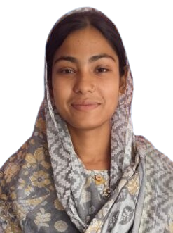

<div align="center">
  
</div>

<h1 align="center">✨ Bilkis Parban Portfolio ✨</h1>

<p align="center">
  
  
  
  
</p>

<p align="center">
  
</p>

<p align="center">
  A modern, responsive portfolio website crafted to showcase my learning journey, education, skills, and contact information with a clean visual style.
</p>

---

## 🌸 About this project

This repository contains a personal portfolio website for Bilkis Parban. It is designed to feel elegant, approachable, and professional while highlighting:

- Academic background and learning journey
- Essential skills and growth path
- Personalized hero section and polished layout
- Quick contact links for email, LinkedIn, and Facebook
- Mobile-friendly user experience

---

## ✨ Highlights

- Modern landing page with soft gradients and premium styling
- Smooth scroll and reveal animations
- Clear sections for About, Education, Skills, and Contact
- Flexible color and layout customization
- Designed to be easy to run locally in a browser

---

## 🛠️ Tech Stack

- HTML5
- CSS3
- JavaScript
- Google Fonts
- Responsive design principles

---

## 🚀 Run locally

1. Open the project folder.
2. Launch `index.html` in your browser.
3. If you want to preview it in a local server, you can also use a simple static server.

```bash
python -m http.server 8000
```

Then visit:

```text
http://localhost:8000
```

---

## 🎨 Customize it

- Replace the profile image with your own photo and keep it named `MyPhoto.png` in the project root.
- Update your school, skills, and contact details inside `index.html`.
- Adjust colors, spacing, and animations in `styles.css` and `contact.css`.
- Fine-tune behavior in `script.js` if needed.

---

## 📬 Contact

- Email: `parbinbilkis374@gmail.com`
- LinkedIn: click the profile link in the site
- Facebook: click the profile link in the site

<p align="center">
  <a href="#top">⬆ Back to top</a>
</p>

<p align="center">
  
</p>

---

<p align="center">
  <em>Built with care by Bilkis Parbin</em>
</p>
